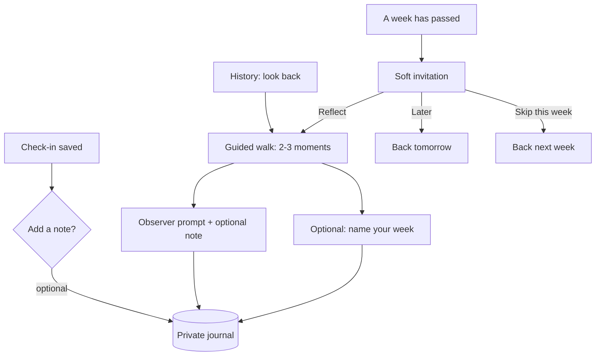

# Weekly Reflection and Private Journal

## Summary

Add a private journal and a weekly reflection to Constellation. Any saved check-in can take an optional typed note. Once a week, a soft invitation opens a guided walk back through the week's check-ins, ending with an optional name for the week. "Look back" is also available on demand from History.

---

## Problem Frame

People seeing Constellation for the first time asked "Why? What am I doing, and why does this exist?" They aren't the core audience, but the reaction shows the utility isn't visible to a new user. Checking in is low-friction, and the record grows, but nothing in the product shows what the record is *for*.

One piece of feedback named the gap: tracking emotions pays off when you review your own trends. The review doesn't need conclusions. Looking at how the week went, and linking moments to what was happening, is where clarity and introspection come from. Constellation records the *when* and the *where* of a feeling but never the *what was going on*, and it never invites the user to look back on purpose. History exists, but it's a place you have to think to visit, and nothing in it asks a question.

The clinical practice below says the same thing. Every therapist-led tracking tool pairs the feeling with its context and then reviews the pairs on a regular rhythm. Constellation does the first half well.

---

## Research: what therapists recommend, and why

This research shapes the requirements below. Each finding names the requirements it drives.

**1. Linking feelings to what happened is the step therapists add on top of tracking.** CBT and behavioral activation use activity-and-mood diaries, which the therapist and client review together to see which activities moved mood. DBT diary cards are reviewed weekly at the start of each session to find patterns ("anger peaks in the late afternoon"). Yale's RULER model (Recognize, Understand, Label, Express, Regulate), the basis for the How We Feel app, makes understanding the cause its own step. Constellation already covers Recognize and Label; this feature adds Understand. → R1–R4, R10–R14.

**2. A weekly review corrects a memory error.** When people summarize a week from memory, they report it as more intense than momentary reports show, with extra weight on the peaks and the most recent moments (the peak-end effect). The check-ins hold the week as it happened. Looking back is partly comparing the story you tell yourself about the week with the record. That is the plain answer to "why does this exist?": see your week as it happened, not as you remember it. → R10, R20.

**3. Context goes stale fast, so capture it in the moment.** The clinical diaries record context alongside the feeling, not days later, for the same memory reason. Asking on Sunday what was happening on Tuesday reintroduces the error in point 2, now about events. This is why notes attach to check-ins as well as to the reflection. → R1–R4.

**4. Short works, and talking works.** The standard expressive-writing protocol is 15–20 minutes, but a small study found benefit from 2 minutes on 2 days (Burton & King 2008). Pennebaker's 1997 review reports that talking into a recorder produced effects comparable to writing (Esterling et al. 1994). One sentence is a valid entry, and voice is a legitimate future input. → R5, R13; voice deferred.

**5. Reflection can turn into rumination, depending on the angle.** Kross's work found that asking "why did I feel that way?" helps from a distanced, observer perspective and hurts when you replay the moment from the inside. Prompts should start from the data and look from outside ("Thursday sat bright and activated. What was going on?"), never "why were you sad?" → R12.

**6. Look at good moments as well as hard ones.** A small trial of positive-affect journaling (Smyth et al. 2018, 70 patients, 12 weeks) found less distress and more resilience compared with usual care. A reflection that only digs into low points becomes a problem-hunt. → R11.

**7. Privacy is part of why journaling works.** Pennebaker argues that writing for no audience removes the fear of judgment. Therapists also warn that an emotional entry can leave you briefly feeling worse, so stepping away should be easy and free of guilt. → R6, R15, R16, Key Decisions.

**8. The evidence is real but modest.** The largest expressive-writing meta-analysis (Frattaroli 2006, 146 studies) found a small average effect (r ≈ .075), and some later meta-analyses found none for depression. Evidence that mood tracking builds emotional self-awareness is early (Kauer et al. 2012, a secondary analysis of 114 young people). Product copy should promise noticing, not healing. → R20.

---

## Key Decisions

- **Notes come after the save, never inside the check-in.** The check-in stays complete without them, so the low-friction promise holds. The saved check-in confirmation card is the natural place for the note: the check-in is done, and context is freshest.
- **One journal with two kinds of note.** A note written at check-in time and a note written later during a reflection both attach to the same check-in, and both stay visible as different kinds. The gap between what you said in the moment and what you said looking back is worth keeping.
- **The app picks the moments, and every pause can be skipped.** A guided walk does more than a blank page for a user who doesn't yet know how to spot patterns. Contrast keeps it from always zooming in on the worst moment.
- **No AI, no generated insights.** The user does the noticing; the app sets up the view and asks one question at a time. An automatic "you feel worse on Mondays" verdict would undercut both the ask-never-assert rule and the self-reflection that is the point.
- **Text only in v1.** Voice is supported by the research (Research 4) and stays the intended next input. It waits until the reflection loop has proven itself, not because of storage.
- **Storage limits don't shape this design.** The journal lives on the device until the user exports it or creates an account. Losing it when browser data is cleared is expected behavior, and the app says so plainly, not as fine print.
- **Invitations, not obligations.** No streak, no count of weeks reflected, no reflection that unlocks anything (frankbrain `EmotionSelector-MotivationModel.md`). Snoozing is first-class, and missed weeks roll into the next one instead of piling up.

---

## Key Flows

- F1. Adding a note to a check-in
  - **Trigger:** The user saves a check-in on any surface.
  - **Steps:** The saved check-in confirmation card shows a quiet "add a note" affordance. The user types a line, or ignores it. Reopening a saved check-in later allows adding or editing its note.
  - **Outcome:** The check-in carries an at-the-time note, or none.
  - **Covered by:** R1–R5

- F2. The weekly reflection
  - **Trigger:** The user accepts the weekly invitation, or chooses "look back" in History.
  - **Steps:** The week's check-ins replay in time order. The walk pauses on 2–3 contrasting moments. Each pause shows the moment, any note written at the time, and one observer-style prompt with an optional note field. After the last pause, an optional open line ("anything you noticed?") and an optional name for the week.
  - **Outcome:** A reflection record for the week. Notes added during it attach to their check-ins as looking-back notes.
  - **Covered by:** R10–R16

- F3. Snoozing the invitation
  - **Trigger:** The invitation is showing.
  - **Steps:** The user chooses "Later" or "Skip this week", or just checks in and ignores it.
  - **Outcome:** "Later" hides it until the next day. "Skip this week" hides it until the next week becomes eligible.
  - **Covered by:** R7–R9

---

## Requirements

**Notes on check-ins**

- R1. The saved check-in confirmation card offers an optional, quiet "add a note" affordance on every surface (web, new tab, first-ever check-in).
- R2. Adding a note is never required, and the card's existing behavior is unchanged when the user ignores it.
- R3. A note can be added or edited when reopening a saved check-in.
- R4. A check-in's notes appear in its entry detail in History, with at-the-time and looking-back notes told apart.
- R5. A note can be any length, and one short line is the expected case. The affordance's copy and size invite a sentence, not an essay.
- R6. The first time a user writes any note, the app states once, plainly, that the journal lives in this browser, is lost if browser data is cleared, and can be kept by exporting (and later by an account).

**The invitation**

- R7. The invitation becomes eligible when at least 7 days have passed since the last completed invited reflection or skip (or since the first check-in, if none), and at least one check-in falls in the last 7 days. On-demand reflections from History don't reset this.
- R8. On the web landing, the invitation appears as a soft, secondary element beside the check-in. On new tab, it is a quiet secondary link beside the sliders on the focus card and the first-check-in card. The check-in stays the primary action on both.
- R9. The invitation offers "Later" (hidden until the next calendar day) and "Skip this week" (hidden until the next eligibility). An unanswered invitation always covers the most recent 7 days, so missed weeks never stack.

**The reflection**

- R10. A reflection covers the 7 days ending on the day it starts. It replays the week's check-ins in time order, reusing the visual language of the constellation replay.
- R11. The walk pauses on up to 3 moments chosen for contrast: the most pleasant, the least pleasant, and the one furthest from the week's center. With 3 or fewer check-ins in the week, it pauses on each of them.
- R12. Each pause shows one observer-style prompt grounded in the moment's day and position on the field. Prompts ask what was going on and never ask why the user felt a certain way. Wording varies so prompts don't read as a formula.
- R13. Each pause offers an optional note field and a way to move on without writing. Notes written here attach to that check-in as looking-back notes.
- R14. Where a moment already has an at-the-time note, the pause shows it before the prompt.
- R15. After the last pause, the reflection offers an optional open line ("anything you noticed?") and an optional name for the week. Both can be left blank.
- R16. The user can leave a reflection at any point without a warning or a guilt-inducing message. Reaching the end counts as completed, even with nothing written.
- R17. A named week shows its name above the week chart in History, and the name can be renamed or cleared there.

**On-demand and history**

- R18. History offers "look back" on demand once at least 2 check-ins exist, regardless of whether an invitation is due.

**Data and permanence**

- R19. Automatic pruning never removes notes, reflections, or week names without the user's action, and never removes a check-in that has a note.
- R20. Product copy introduces the reflection as seeing your week as it happened. The first saved check-in card carries one line setting that expectation. No copy promises therapeutic outcomes.
- R21. CSV export includes check-in notes, reflection notes, open lines, and week names.

---

## Acceptance Examples

- AE1. **Covers R7, R9.** Given the last reflection was skipped 4 days ago, when the user opens a new tab, then no invitation shows. Given it was skipped 7 days ago and there are 2 check-ins in the last 7 days, then the invitation shows.
- AE2. **Covers R9.** Given the user taps "Later" in the morning, when they open another tab that afternoon, then no invitation shows. The next morning, it shows again.
- AE3. **Covers R7.** Given 9 days have passed since the last reflection but no check-ins fall in the last 7 days, when the user lands, then no invitation shows.
- AE4. **Covers R11.** Given a week with 2 check-ins, when the reflection runs, then it pauses on both. Given a week with 9, then it pauses on 3: the most pleasant, the least pleasant, and the most distinct.
- AE5. **Covers R13, R16.** Given the user is on the second pause, when they move on without writing and then close the reflection, then nothing is written, no warning shows, and the reflection is not recorded as completed.
- AE6. **Covers R4, R13, R14.** Given a check-in with the at-the-time note "big meeting", when the reflection pauses there and the user writes "it went fine, the dread was worse than the meeting", then entry detail in History shows both notes, marked as at-the-time and looking-back.
- AE7. **Covers R18.** Given a user with exactly 2 check-ins and no invitation due, when they open History, then "look back" is available.
- AE8. **Covers R19.** Given a diary at the pruning threshold where the oldest entry has a note, when pruning runs, then that entry is kept.

---

## Success Criteria

- A new user can answer "what is this for?" after their first check-in, from the product alone.
- A full reflection can be finished in under 3 minutes with nothing typed.
- The reflection reads as an invitation: no copy, count, or state treats a skipped week as a failure.
- Dogfooding: after a few weeks, re-reading earlier looking-back notes tells you something the coordinates alone did not.

---

## Scope Boundaries

**Deferred for later**

- Voice notes. The intended next input; the research supports them (Research 4). Transcription must not send audio to a cloud service without disclosure.
- **The lake.** If stargazing means looking up at the night sky, reflecting means looking down at a lake surface that mirrors the brightest constellations, the ones the user recorded. A visual direction for the reflection, paired with the night-sky field (`docs/brainstorms/2026-09-28-night-sky-field-requirements.md`).
- Turning History into the reflection's home: reworking the History entry point so "what happens when you click" is the reflection, not a chart.
- Reflecting on an earlier week chosen from History; v1 reflects on the most recent 7 days.
- Searching or browsing the journal as its own view.
- Landing-page (`landing.html`) messaging changes. Copy inside the app is covered by R20.

**Outside this product's identity**

- AI-written summaries or automatic "patterns found" verdicts.
- Linking notes to calendar, health, weather, or location data.
- Sharing reflections, or any view of another person's week.
- Streaks, counts of weeks reflected, or anything a reflection unlocks.

---

## Dependencies / Assumptions

- Builds on the saved check-in confirmation card (`src/components/EmotionPreview/SavedCheckInSummary.tsx`), the new-tab cards (`src/components/EmotionPreview/DepartureFloat.tsx`), the constellation replay (`src/components/Constellation/ConstellationReplay.tsx`), the History week view, and CSV export (`src/utils/diaryCsv.ts`).
- Check-ins carry no note or free text today (`DiaryEntry` in `src/types.ts`).
- The diary prunes its oldest 50 entries at 500 (`src/store/diary.ts`). R19 requires changing this for annotated entries.
- Assumes "most pleasant", "least pleasant", and "furthest from center" can be read off the coordinates of the `radial-intensity` framework without word labels.

---

## Outstanding Questions

**Deferred to Planning**

- Where journal content is stored, and whether it lives alongside diary entries or as its own records. R19 and R21 fix the behavior, not the storage.
- The exact definition of "furthest from the week's center" (R11), and the tie-break when one check-in qualifies for two slots.
- The prompt set and the rules for varying it (R12). It needs a copy pass of its own against the ask-never-assert rule.
- How the invitation sits in the web landing's layout next to the previous-check-in ring and sliders (R8).

---

## Sources

- [Frattaroli 2006, experimental disclosure meta-analysis](https://Www.Gwern.net/doc/psychology/2006-frattaroli.pdf)
- [Burton & King 2008, two-minute writing](https://pubmed.ncbi.nlm.nih.gov/18230223/)
- [Pennebaker 1997, writing about emotional experiences](https://sanlab.psych.ucla.edu/wp-content/uploads/sites/31/2016/03/Pennebaker_Psychscience_1997.pdf)
- [Kross et al., self-distancing and adaptive self-reflection](https://pmc.ncbi.nlm.nih.gov/articles/PMC2881638/)
- [Lieberman et al. 2007, affect labeling](https://pubmed.ncbi.nlm.nih.gov/17576282/)
- [Emotional granularity review](https://www.frontiersin.org/articles/10.3389/fpsyg.2022.1080713/full)
- [Kauer et al. 2012, mobile mood monitoring RCT](https://doaj.org/article/a3babaaddcb447dc94efa06d5b39c0c2)
- [Smyth et al. 2018, positive affect journaling](https://mental.jmir.org/2018/4/e11290)
- [Retrospective vs. momentary affect reports](https://pmc.ncbi.nlm.nih.gov/articles/PMC6842033)
- [Fredrickson 1997, peak and end in mood recall](https://www.affective-science.org/pubs/1997/FB97.pdf)
- [Behavioral activation activity diary](https://www.psychologytools.com/resource/behavioral-activation-activity-diary)
- [DBT diary card](https://www.addictionhelp.com/treatment/dialectical-behavioral-therapy/diary-card/)
- [How We Feel (Yale Center for Emotional Intelligence)](https://medicine.yale.edu/news-article/the-how-we-feel-app-helping-emotions-work-for-us-not-against-us/)
- [RULER Mood Meter tip sheet](https://www.rulerapproach.org/wp-content/uploads/2023/03/Mood-Meter-Tip-Sheet.pdf)
- frankbrain `wiki/concepts/emotion-selector/EmotionSelector-MotivationModel.md`: no rewards, streaks, or points
