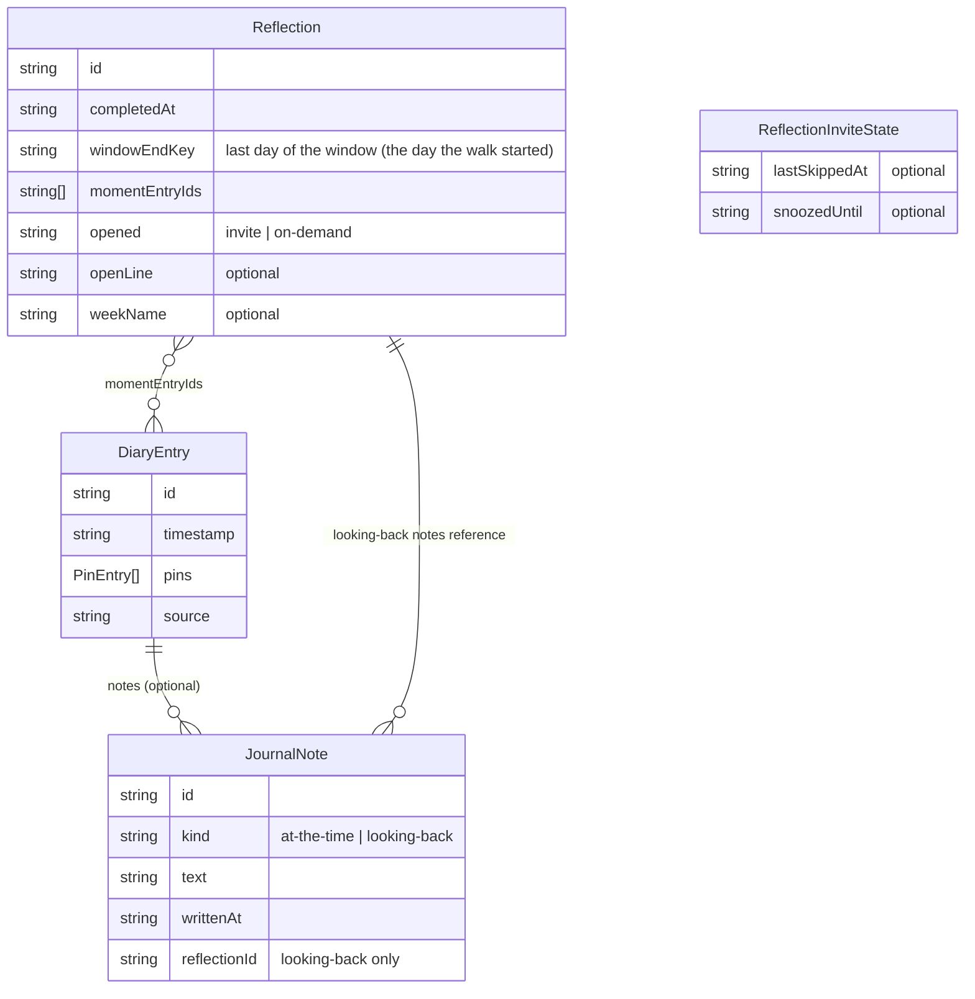
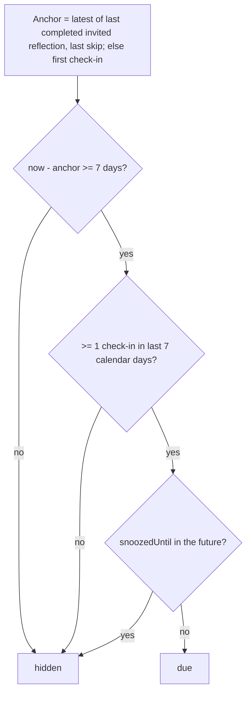
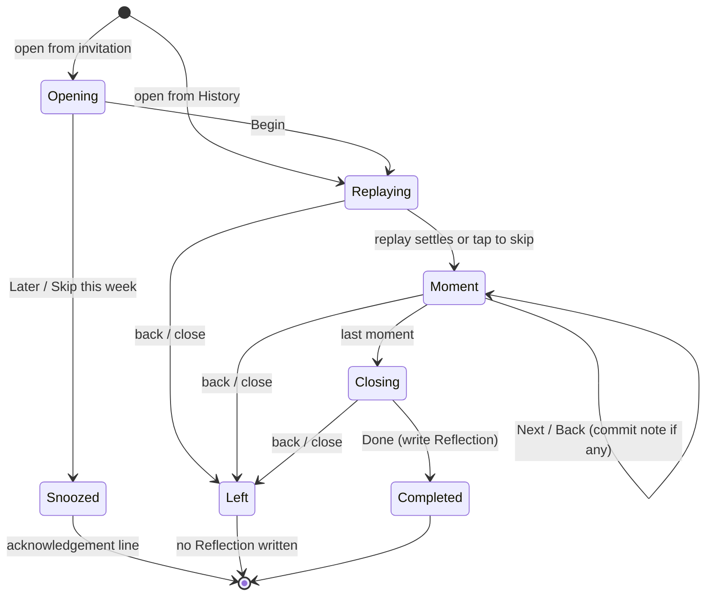

# feat: Weekly reflection and private journal

## Summary

Give check-ins an optional typed note. Add a weekly reflection: a guided walk through the week's check-ins that pauses on 2–3 contrasting moments with observer-style prompts, then offers an optional name for the week. A soft invitation appears on the web rail and beside the new-tab sliders, with "Later" and "Skip this week". History gets "look back" on demand, shows week names, and exports notes and reflections.

---

## Problem Frame

New users asked "why does this exist?". Constellation records when and where a feeling sits but never what was going on, and nothing invites the user to look back. Therapist-led tracking (CBT activity diaries, DBT diary cards, RULER's "Understand" step) pairs each feeling with its context and reviews the pairs weekly. This plan adds that half (see origin: `docs/brainstorms/2026-10-09-weekly-reflection-journal-requirements.md`, Research section).

---

## Requirements

All 21 origin requirements are in scope except one part of R3: editing a note from the field's reopen flow is deferred (KTD7, Scope Boundaries). Grouped as in the origin; see it for full wording.

**Notes on check-ins**
- R1. The saved check-in card offers an optional "add a note" on every surface.
- R2. Notes are never required; ignoring the affordance changes nothing.
- R3. A note can be added or edited later. In this plan that happens on the saved card and in History's entry detail (KTD7).
- R4. Entry detail shows a check-in's notes, with at-the-time and looking-back notes told apart.
- R5. Notes have no length limit, and the affordance invites a sentence.
- R6. The first time a user writes a note, the app states once that the journal lives in this browser.

**The invitation**
- R7. Eligible at ≥7 days since the last completed invited reflection or skip (or the first check-in), with ≥1 check-in in the last 7 days. On-demand reflections from History don't move this timer (KTD15).
- R8. On web it sits on the rail/sheet beside the check-in. On new tab it is a quiet link beside the sliders.
- R9. "Later" hides it until the next calendar day; "Skip this week" hides it until the next eligibility. It always covers the most recent 7 days.

**The reflection**
- R10. Covers the 7 days ending on the day it starts, replaying the week in time order.
- R11. Pauses on up to 3 moments: most pleasant, least pleasant, furthest from the week's center. Weeks with ≤3 check-ins pause on each.
- R12. One observer-style prompt per pause, grounded in day and position; never asks why.
- R13. Each pause has an optional note and a way to move on. Notes attach to the check-in as looking-back notes.
- R14. A moment's at-the-time note shows before the prompt.
- R15. Closes with an optional open line and an optional week name.
- R16. Leaving early is free of warnings. Reaching the end counts as completed.
- R17. A named week shows its name in History, above the week chart (KTD16).

**On-demand and history**
- R18. History offers "look back" once ≥2 check-ins exist.

**Data and permanence**
- R19. Pruning never removes notes, reflections, or week names, or any check-in with a note.
- R20. Copy frames the reflection as seeing your week as it happened. The first saved check-in carries one line setting that expectation.
- R21. CSV export includes notes, open lines, and week names.

**Origin acceptance examples carried:** AE1–AE8 (see origin). Each is enforced by a test scenario below.

---

## Key Technical Decisions

- KTD1. **Notes live on `DiaryEntry` as an optional `notes` array.** Each note records its kind (`at-the-time` or `looking-back`), text, when it was written, and, for looking-back notes, the id of the walk that wrote it. That id groups notes from one walk and need not resolve to a recorded reflection, since an abandoned walk records none. One array keeps a check-in's notes travelling with it through export, pruning, and History. Optional, so every existing entry stays valid.
- KTD2. **`updateEntryInList` carries the original `notes` forward when the update omits them.** The correction path in `App.tsx` `handleRecord` builds a fresh entry object without notes, the same trap `source` already hit (`src/data/checkIn.ts`). Note writes go through a dedicated pure function that always passes notes explicitly.
- KTD3. **Reflections and invitation state get their own `localStorage` keys, behind a thin store.** `src/store/reflections.ts` holds the reflection records, the invitation state (`lastSkippedAt`, `snoozedUntil`), and the one-time journal-notice flag. Pure logic stays in `src/data/` so `check:` scripts run under Node (AGENTS.md testing split).
- KTD4. **Pruning becomes a pure `pruneEntries` that skips annotated check-ins.** At the 500 cap it removes up to the 50 oldest entries without notes. Check-ins with notes are never removed (R19). The cap stays for everything else.
- KTD5. **The reflection window reuses History's last-7-days window.** `last7Days()` plus `entriesInWindow()` from `src/utils/diaryAggregation.ts`, so the reflection and the week view never disagree about which check-ins "this week" holds. `last7Days` gains an optional `now` (default `new Date()`) so the window and invitation checks can run at a fixed clock; History's call sites stay unchanged.
- KTD6. **Moments are picked from coordinates alone.** Valence is `y` and arousal is `x` in every framework, so "pleasant", "least pleasant", and "furthest from center" need no word labels. Multi-pin legacy entries are placed at their last pin, the point `DrawnConstellation` draws, so the picked moment and the highlighted star always match. Do not use `sessionAverage` here: its fields are named backwards (its `valence` is the mean of `x`). Ties go to the earlier check-in, and one check-in fills at most one slot.
- KTD7. **Notes are edited on the saved card and in History's entry detail, not in the field's tag editor.** This keeps `CoordinateCard.tsx` (548 lines) and the reopen flow out of the change. Reopening on the field still edits tags only.
- KTD8. **The reflection is a new `AppView`, `'reflection'`, opened through `useViewHistory`.** Browser back and an in-app close both leave it with no confirmation (R16), the same mechanism History and replay already use.
- KTD9. **The walk reuses `DrawnConstellation`** with four optional props: a highlighted entry, a hidden scrubber, `onReplayEnd`, and `jumpToEnd`. `onReplayEnd` fires from the timeline's `onComplete` and right after the reduced-motion `toEnd()`, so the walk knows when to pause on the first moment. `jumpToEnd` seeks the timeline to its end (tap-to-skip) and fires `onReplayEnd` the same way. One replay language across the app (R10), and its anime.js timeline already honors reduced motion through `useAnimeScope`.
- KTD10. **A note is committed when the user moves on.** "Next", "Back", or "Done" saves a non-empty note, and clearing a previously saved one removes it; leaving mid-walk keeps notes already committed but records no reflection (AE5). No autosave on every keystroke, and no half-written drafts sitting in storage.
- KTD11. **Invitation status is derived at render, never stored.** One pure `inviteStatus(entries, reflections, inviteState, now)` returns `due` or `hidden`, mirroring how `derivePreviousCheckIn` derives instead of storing (AGENTS.md: derive at render).
- KTD12. **Where the invitation shows depends on the session's source.** Web sessions show an invitation card (Reflect, Later, Skip this week) at the top of the rail/sheet list, only while no draft pin exists. On mobile, where the sheet starts collapsed, the peek handle carries one quiet line that expands the sheet to the card; the sheet never auto-expands. New-tab sessions show a single quiet "Look back on your week" link inside the returning-user `DepartureFloat`; Later and Skip this week live on the walk's opening card instead (KTD17). The rail never repeats the invitation after a new-tab save.
- KTD13. **Reflections export as a second CSV.** Check-in rows gain two note columns. Reflections (end date, moment count, open line, week name) go in `emotions-wheel-reflections-YYYY-MM-DD.csv` through a separate History link. Every check-in row stays one chartable point.
- KTD14. **Prompts come from a fixed template set, rotated deterministically.** Templates fill in a day phrase and a plain-language position phrase. A deterministic offset (seed mod template count, seeded from the reflection's start) keeps wording varied (R12) without randomness in tests. A check asserts no template contains "why".
- KTD15. **Only invited reflections move the invitation timer.** Each `Reflection` records whether it was opened from the invitation or on demand. `inviteStatus` anchors on the latest invited completion or skip, so a midweek look-back from History leaves the weekly rhythm alone.
- KTD16. **The week name is a subtitle above History's week chart.** It shows when a named reflection finished inside the visible 7 days (latest wins), as a quiet line such as "the long one · week ending Oct 9". The finishing day's row gets a small marker, and day detail shows the name, so older weeks stay findable. The name can be renamed or cleared where it shows.
- KTD17. **A walk opened from an invitation starts on an opening card.** It offers Begin, Later, and Skip this week over the start of the replay. Later and Skip close the walk, and the surface it returns to shows a short line that fades ("Okay, tomorrow." / "Okay, next week."). Opened on demand from History, the walk skips this card.

---

## High-Level Technical Design

**Data shape.** Notes ride on the check-in; reflections and invitation state are separate records.

**Invitation status.** Evaluated at render by `inviteStatus`.

**Reflection walk.**

---

## Implementation Units

### U1. Journal data model and storage

**Goal:** Add notes to check-ins, reflection and invitation records, and a pruning policy that protects notes.

**Requirements:** R2, R3, R19; AE8

**Dependencies:** none

**Files:**
- `src/types.ts`: `JournalNote`, `Reflection`, `ReflectionInviteState`; optional `notes` on `DiaryEntry`; `'reflection'` in `AppView`
- `src/data/journal.ts` (new, pure): `upsertAtTimeNote`, `addLookingBackNote`, `notesByKind`, `pruneEntries`
- `src/data/checkIn.ts`: `updateEntryInList` preserves `notes` (KTD2)
- `src/store/diary.ts`: `appendEntry` uses `pruneEntries`; new `setEntryNotes` wrapper
- `src/store/reflections.ts` (new): read/append reflections, update a reflection's week name, read/write invite state, journal-notice flag
- `src/hooks/useDiary.ts`: expose a `setNotes(entryId, notes)` write
- `src/hooks/useReflections.ts` (new): reflections + invite state + actions (complete, rename week, skip, snooze)
- `scripts/test-journal.ts` (new), `scripts/test-check-in.ts` (extend), `package.json` (`check:journal`)

**Approach:**
- `upsertAtTimeNote` replaces the single at-the-time note, or removes it when the text is blank. `addLookingBackNote` appends one per walk per check-in, replacing an earlier one with the same walk id, and removes it when the text is blank, so the same function serves editing from History.
- The reflections store also supports renaming or clearing a reflection's week name.
- `pruneEntries(entries, max, count)` drops the oldest un-noted entries only. It is a no-op below the cap.
- `updateEntryInList` carries notes forward only when the `notes` key is absent from the update. Note writes always pass an explicit array, possibly empty. An entry counts as noted only when `notes?.length > 0`.
- Store wrappers wrap every read and write in try/catch, matching `readDiary`.

**Patterns to follow:** `src/data/checkIn.ts` (pure module plus store wrapper), `src/data/groundingCues.ts` (localStorage flag behind a pure function).

**Test scenarios:**
- Happy path: `upsertAtTimeNote` on an entry without notes adds one at-the-time note with the given text.
- Happy path: calling it again replaces the text and keeps a single at-the-time note.
- Edge case: blank or whitespace-only text removes the at-the-time note.
- Happy path: `addLookingBackNote` with walk `r1` twice keeps one note for `r1`. A second walk `r2` adds a second note.
- Edge case: `addLookingBackNote` with blank text for `r1` removes that note and leaves `r2`'s.
- Integration: `updateEntryInList` with an update lacking `notes` keeps the original notes. With explicit `notes`, it uses the new ones.
- Covers AE8. `pruneEntries` at 500 entries where the oldest has a note keeps that entry and removes the 50 oldest un-noted.
- Edge case: `pruneEntries` where fewer than 50 entries lack notes removes only those, never a noted one.
- Edge case: `pruneEntries` below the cap returns the input unchanged.
- Edge case: clearing an entry's only note through the note-write path leaves zero notes; the old note is not carried back.
- Edge case: an entry with `notes: []` is prunable.

**Verification:** `check:journal` and `check:checkin` pass, and existing diaries without `notes` load unchanged.

---

### U2. Reflection logic

**Goal:** Pure functions for the window, moment picking, prompts, invitation status, and snooze.

**Requirements:** R7, R9, R10, R11, R12, R18; AE1, AE2, AE3, AE4, AE7

**Dependencies:** U1

**Files:**
- `src/data/reflection.ts` (new, pure): `reflectionWindow`, `pickMoments`, `momentPrompt`, `inviteStatus`, `laterUntil`, `canLookBack`
- `src/data/reflectionPrompts.ts` (new): template set and position/day phrase helpers
- `src/utils/diaryAggregation.ts`: `last7Days(now = new Date())`
- `scripts/test-reflection.ts` (new), `package.json` (`check:reflection`)

**Approach:**
- `reflectionWindow(entries, now)` returns the last 7 calendar days' entries, oldest first (KTD5). It and `inviteStatus` pass `now` through to `last7Days`.
- `pickMoments(windowEntries)` returns all entries when there are ≤3. Otherwise it picks max-`y`, min-`y`, then the farthest from the window's mean coordinate among the rest, ordered by time (KTD6).
- `momentPrompt(entry, index, seed, now)` combines a day phrase (today, yesterday, weekday name) with a position phrase from bands on `y` (pleasant / even / heavy) and `x` (calm / activated). Template rotation follows KTD14.
- `inviteStatus` follows the High-Level Technical Design flowchart. `laterUntil(now)` returns the next local midnight. `canLookBack(entries)` is `entries.length >= 2`.

**Patterns to follow:** `src/data/departure.ts` (`relativeDayLabel` and the plain-language delta bands), `src/data/groundingCues.ts` (`pickCueIndex` rotation).

**Test scenarios:**
- Covers AE4. A week with 2 entries returns both. A week with 9 returns 3: the max-`y`, the min-`y`, and the farthest from the mean.
- Edge case: when one entry is both max-`y` and farthest from the mean, it fills one slot and the next-farthest fills the third.
- Edge case: equal `y` values pick the earlier entry.
- Happy path: moments come back in chronological order regardless of selection order.
- Edge case: a legacy multi-pin entry is placed by its last pin, matching the star `DrawnConstellation` draws.
- Happy path: "most pleasant" picks the highest `y`, not the highest `x`.
- Covers AE1. Last skip 4 days ago → `hidden`. Last skip 7 days ago with 2 check-ins in the window → `due`.
- Covers AE3. 9 days since the last reflection with zero check-ins in the last 7 calendar days → `hidden`.
- Covers AE2. `snoozedUntil` set to the next midnight hides the invitation that afternoon and shows it after midnight.
- Happy path: with no reflections and no skips, the anchor is the first check-in; 6 days after it → `hidden`, 7 days → `due`.
- Happy path: an invited reflection completed 3 days ago → `hidden`, even when the last skip was older.
- Happy path: an on-demand reflection completed 3 days ago does not move the anchor; with the last invited reflection 8 days ago and a recent check-in → `due`.
- Covers AE7. `canLookBack` is false with 1 entry and true with 2.
- Edge case: no template, after filling, contains "why" (case-insensitive).
- Happy path: two reflections with different seeds produce different prompt wording for the same moment.

**Verification:** `check:reflection` passes.

---

### U3. Notes on the saved card and in entry detail

**Goal:** Users can write, read, and edit notes. The first note triggers the storage notice, and the first saved check-in sets the expectation of looking back.

**Requirements:** R1, R2, R3, R4, R5, R6, R20; AE6 (display half)

**Dependencies:** U1

**Files:**
- `src/components/Journal/NoteEditor.tsx` (new): quiet affordance that expands to an autosizing textarea; commits on Save; shows the storage notice while the flag is unset
- `src/components/EmotionPreview/SavedCheckInSummary.tsx`: "+ Add a note" beside "+ Add tags"; first-check-in expectation line
- `src/components/DiaryHistory/SessionDetailCard.tsx`: at-the-time note and looking-back notes, each editable and clearable with NoteEditor; looking-back notes labelled with the date they were written
- `src/components/EmotionPreview/EmotionDrawer.tsx`: pass through the note props
- `src/App.tsx`: `handleSetAtTimeNote(entryId, text)` writing via `useDiary`; is-first-check-in flag for the saved card
- `src/components/DiaryHistory/DiaryHistory.tsx`, `src/components/Constellation/ConstellationReplay.tsx`: pass the note write to `SessionDetailCard`; hold `openEntryId` instead of an entry snapshot and resolve the entry from `entries` at render, so a saved note shows at once
- `src/components/Constellation/ConstellationReplay.tsx`: memoize the replay window on entry ids, timestamps and pin coordinates rather than array identity, so a note save doesn't restart the replay

**Approach:**
- The affordance matches "+ Add tags": same dotted-underline text button, `--ui-text-3`. The textarea uses FIELD_SERIF and theme tokens only (AGENTS.md, `check:theme`).
- The notice copy (draft): "Notes stay in this browser. Clearing browser data erases them — export from History to keep a copy." The flag is set on the first successful commit, so the notice shows exactly once.
- The expectation line (draft): "Check in through the week, then look back and see it as it happened." It shows when this is the user's only entry.
- NoteEditor states: collapsed affordance; expanded and empty; expanded with a draft; saved (text shown with a quiet "Edit"). Escape or "Cancel" discards the draft. Blur keeps the draft open and unsaved.
- A failed write shows a quiet inline line ("Couldn't save that note") instead of failing silently; the store wrapper reports success or failure for this.
- Accessibility: the textarea has a visible label; Save and Cancel are reachable by keyboard; touch targets are at least 44px.
- Copy gets a dedicated pass against the ask-never-assert rule before shipping.

**Patterns to follow:** `SavedCheckInSummary`'s "+ Add tags" button; `handleRecognizeSaved` in `src/App.tsx` (write-through to a saved entry).

**Test scenarios:**
- Test expectation: no component harness exists (AGENTS.md). Write behavior is covered by U1's `check:journal`; verify the UI live:
- Saving a check-in without touching the note leaves the card unchanged and the entry without `notes`.
- Writing "big meeting" and saving shows the note on the card and in History's entry detail as at-the-time.
- The first note shows the storage notice; a second note on another check-in does not.
- Clearing the note's text and saving removes it.
- A brand-new user's first saved card shows the expectation line; their second does not.
- Correcting a check-in's coordinate through reopen keeps its note (KTD2, live check).
- Saving a note in History's entry detail shows it without reopening the card.
- Saving a note from the replay's detail card does not restart the replay behind it.
- Escape while editing discards the draft and keeps the saved note.
- Editing a looking-back note in entry detail updates it; clearing it removes it and leaves the at-the-time note.

**Verification:** Notes round-trip through save, reload, History, and coordinate correction, in both rail and mobile sheet layouts.

---

### U4. The reflection walk

**Goal:** A full-surface reflection view that replays the week, pauses on moments, takes notes, and records completion.

**Requirements:** R10, R11, R12, R13, R14, R15, R16, R20; AE5, AE6

**Dependencies:** U1, U2, U3

**Files:**
- `src/components/Reflection/WeeklyReflection.tsx` (new): replay → moments → closing (state machine above)
- `src/components/Reflection/ReflectionOpening.tsx` (new): Begin / Later / Skip this week, shown when opened from an invitation (KTD17)
- `src/components/Reflection/ReflectionMoment.tsx` (new): progress, at-the-time note (if any), prompt, NoteEditor, Back, Skip/Next
- `src/components/Reflection/ReflectionClosing.tsx` (new): open line, week name, Done
- `src/components/Constellation/DrawnConstellation.tsx`: optional `highlightEntryId`, `showScrubber`, and `onReplayEnd` props (KTD9)
- `src/App.tsx`: render `view === 'reflection'`; `openReflection()` via `navigateTo`; completion handler
- `src/hooks/useReflections.ts`: `complete(reflection)`

**Approach:**
- On open, compute the window and moments once and freeze them for the session, so a check-in saved in another tab doesn't reshuffle the walk.
- Layout: on mobile the constellation sits on top and the moment card below; on desktop the card sits beside the sky.
- Opened from an invitation, the walk starts on the opening card (KTD17). Opened from History, it starts the replay directly.
- The replay plays the week. A tap on the sky or any key jumps to the first moment (`jumpToEnd`); a small "tap to skip" hint fades in after a second.
- At each pause the highlighted star moves to the moment while the card changes. Highlight uses existing star/ring visuals at higher opacity. The card shows quiet progress ("1 of 3") and a Back control on every moment after the first; Back reopens the previous moment with its saved note in the editor.
- One forward button reads "Skip" while the note is empty and "Next" once something is typed.
- Each Next/Back commits the note with `addLookingBackNote` (KTD10). Done writes the `Reflection` record with its `opened` source (KTD15), including when the open line and week name are blank.
- Done returns to wherever the walk was opened (`goBack`), and that surface shows one quiet line that fades.
- Close/back calls `goBack`. Nothing prompts, and no reflection is recorded.
- Motion follows the repo's no-bounce rule (springs near critical damping) and honors `useReducedMotion`.
- Accessibility: on open and on each pause, focus moves to the moment's heading, and the prompt sits in a polite live region. The textarea is not auto-focused, so the mobile keyboard doesn't cover the constellation unbidden. Escape leaves the walk. The prompt's day and position phrase is the text equivalent of the highlighted star. Controls are at least 44px, and with the keyboard up, Next stays visible above it.
- With an empty window (reachable only from History when nothing falls in the last 7 days), show one quiet line instead of the walk: "Nothing recorded this week yet."

**Patterns to follow:** `src/components/Constellation/ConstellationReplay.tsx` (full-surface takeover, axis labels, back button); `useViewHistory` overlay views.

**Test scenarios:**
- Test expectation: selection and prompt logic are covered by U2's `check:reflection`; verify the view live:
- Covers AE5. Move past the second pause without writing, then close: no note written, no warning, no reflection recorded, and the invitation is still due.
- Covers AE6. A check-in with at-the-time note "big meeting" shows it at its pause; writing a reply there makes History show both notes, labelled.
- A 2-check-in week pauses twice, then closes.
- Finishing an invited walk with blank open line and week name records a completed reflection and hides the invitation. Finishing an on-demand walk records one but leaves a due invitation showing (KTD15).
- Browser back from mid-walk returns to the surface that opened it: the field, or History for "Look back".
- Tapping the sky during the replay jumps to the first moment.
- On the second moment, Back reopens the first with its note in the editor; changing it and moving on updates that note.
- Opened from the new-tab link, the opening card's Later closes the walk and the new tab shows "Okay, tomorrow.", which fades; the invitation is gone until tomorrow.
- Reduced motion: the replay resolves without animation and pauses still work.
- Keyboard only: open, write a note, move through every pause, and finish without a pointer; a screen reader announces each new prompt.

**Verification:** A full reflection on a seeded 9-check-in week completes in under 3 minutes with nothing typed (origin success criterion).

---

### U5. Invitation surfaces and "look back"

**Goal:** Surface the invitation on web and new tab with Later / Skip this week, and add "look back" to History.

**Requirements:** R7, R8, R9, R18; AE1, AE2, AE7

**Dependencies:** U2, U4

**Files:**
- `src/components/Reflection/ReflectionInvite.tsx` (new): `card` variant (rail/sheet) with Reflect, Later, Skip this week; `link` variant (new tab), a single "Look back on your week" link; `peek` variant, one quiet line for the collapsed mobile sheet
- `src/components/EmotionPreview/EmotionDrawer.tsx`: render the card variant at the top of the rail/sheet list when `inviteDue && entrySource === 'web' && pins.length === 0`; render the peek variant on the collapsed sheet's handle under the same condition, expanding the sheet on tap; thread `entrySource` in from App
- `src/components/EmotionPreview/DepartureFloat.tsx`: render the link variant under the sliders when not `firstTime`, before the first pin is placed, and the invitation is due
- `src/components/DiaryHistory/DiaryHistory.tsx`: "Look back" control beside Export CSV when `canLookBack`
- `src/App.tsx`: derive `inviteStatus` at render (KTD11); wire reflect / later / skip / look-back

**Approach:**
- The check-in stays primary on both surfaces: the invitation uses secondary text weight and `--ui-text-2/3`, no gold fill.
- Later writes `snoozedUntil = laterUntil(now)`. Skip writes `lastSkippedAt = now`. Both hide the invitation on the next render and show a short acknowledgement line that fades.
- The new-tab link opens the walk with its opening card, where Later and Skip this week live (KTD17).
- New-tab sessions never render the card variant (KTD12), so the rail after a new-tab save stays as it is today.
- Adding the link changes `DepartureFloat`'s height. Its `useMeasuredHeight` and the drawer's `focusCardTop` measurement already track size changes; verify the recede transition is unaffected.

**Patterns to follow:** `SavedCheckInSummary` card shell (surface, recorded-dim border, radius 12); `HEADER_PILL` buttons in `src/App.tsx` for the History control.

**Test scenarios:**
- Test expectation: eligibility and snooze are covered by U2's `check:reflection`; verify the surfaces live with seeded diaries and reflection state:
- Covers AE1. Seed a skip 7 days ago and 2 recent check-ins: web rail shows the card; a new tab shows the link beside the sliders.
- Covers AE2. Tap Later: the invitation is gone on reload the same day.
- Skip this week: the invitation is gone and stays gone after reload.
- Web: placing a pin hides the card; discarding the draft brings it back.
- Web mobile: with the sheet collapsed and the invitation due, the peek handle shows the line; tapping it expands the sheet to the card. The sheet does not auto-expand.
- Later and Skip this week each show their acknowledgement line, which fades.
- New tab: after saving, the rail shows the confirmation card and no invitation card.
- A first-ever new-tab user sees no link (the invitation can't be due yet).
- Covers AE7. History with exactly 2 check-ins shows "Look back"; with 1 it does not.
- Desktop new tab: the focus card's recede-to-rail transition still lands cleanly with the link present.

**Verification:** Invitation behavior matches AE1–AE3 across web desktop, web mobile sheet, and new tab.

---

### U6. History display and export

**Goal:** Week names appear in History and can be renamed or cleared there, and export carries notes and reflections.

**Requirements:** R17, R21

**Dependencies:** U1, U4

**Files:**
- `src/components/DiaryHistory/DiaryHistory.tsx`: week-name subtitle above the week chart, renamable and clearable in place (KTD16); the name in day detail; "Export reflections" link when reflections exist
- `src/components/DiaryHistory/DailySummaryRow.tsx`: small marker on the row for the day a named reflection finished
- `src/utils/diaryCsv.ts`: `note_at_the_time` and `notes_looking_back` columns
- `src/utils/reflectionsCsv.ts` (new): reflections CSV, dated filename, download
- `scripts/test-csv-export.ts` (extend), `scripts/test-reflections-csv.ts` (new), `package.json` (`check:reflections-csv`)

**Approach:**
- The subtitle shows the latest named reflection whose `dateKey(completedAt)` falls in the visible 7 days. The row marker and day detail match on the same key. When two finish the same day, show the latest.
- Looking-back notes join with " | " in one column, each prefixed with the date it was written, so a spreadsheet keeps them on one row.
- The reflections CSV has one row per reflection: `completed_at`, `week_ending`, `moment_count`, `open_line`, `week_name`.

**Patterns to follow:** `src/utils/diaryCsv.ts` (`escapeCsvField`, `csvFilename`, `downloadDiaryCsv`).

**Test scenarios:**
- Happy path: an entry with an at-the-time note exports it in `note_at_the_time` on every pin row of that entry.
- Edge case: a note containing commas, quotes, and a newline round-trips through `escapeCsvField`.
- Happy path: two looking-back notes on one entry join into one `notes_looking_back` cell in the order they were written.
- Edge case: entries without notes export empty note cells, and the column count stays constant.
- Happy path: the reflections CSV has one row per reflection, blank `open_line`/`week_name` cells when skipped, and a dated filename.
- Live: a week named "the long one" shows above the week chart, with a marker on the day it finished and the name in that day's detail.
- Live: renaming the week from the subtitle updates it everywhere; clearing it removes the subtitle and marker.

**Verification:** `check:csv` and `check:reflections-csv` pass; both files open cleanly in a spreadsheet.

---

## System-Wide Impact

- **Data lifecycle.** Pruning changes behavior for the first time since launch: noted entries are permanent until the browser is cleared (KTD4). Reflections are never pruned.
- **Correction path.** Any future code building a fresh `DiaryEntry` must keep `notes` through `updateEntryInList` (KTD2); the check script guards it.
- **Docs to update:** `CLAUDE.md` "What ships today" and data model paragraph; `AGENTS.md` check-script table (`check:journal`, `check:reflection`, `check:reflections-csv`).
- **Accounts/sync later.** Notes are the most sensitive data the app holds. The separate-records shape (KTD1, KTD3) is the shape a future sync layer will carry.

---

## Risks & Dependencies

| Risk | Mitigation |
|---|---|
| Inserting the invitation into `EmotionDrawer` (1,487 lines) disturbs the focus/rail measurement and recede transitions | Card variant renders only in rail/sheet with no draft; link variant lives inside `DepartureFloat`, whose own height measurement already handles content changes. U5 verifies the transition on desktop new tab. |
| Prompt wording reads as clinical or leading | Template set is small and reviewed in one copy pass; `check:reflection` bans "why". |
| `DrawnConstellation` changes regress the replay | New props are optional and default to today's behavior; `check:replay` stays green and the replay is checked live. |
| A tab left open across midnight shows stale invitation status | Status is derived on render; any navigation or check-in re-renders. Acceptable for v1. |

---

## Scope Boundaries

**Deferred for later** (from origin)
- Voice notes.
- The lake visual: reflecting as looking down at a lake that mirrors the brightest constellations.
- Making History the reflection's home.
- Reflecting on an earlier week chosen from History.
- A journal browse/search view.
- `landing.html` messaging.

**Outside this product's identity** (from origin)
- AI summaries or automatic pattern verdicts.
- Linking notes to calendar, health, weather, or location data.
- Sharing reflections.
- Streaks, counts of weeks reflected, or unlocks.

**Deferred to Follow-Up Work**
- Note editing from the field's reopen flow (KTD7).
- Editing a reflection's closing line after Done.
- Removing the 500-entry cap entirely once storage moves off `localStorage`.

---

## Open Questions

**Deferred to implementation**
- Exact band thresholds for the position phrases (U2): tune by reading prompts against real diaries.
- Final copy for the notice, expectation line, prompts, and invitation: one copy pass before merge.
- Highlight treatment for the current moment's star (U4): pick by eye in the browser.

---

## Sources & Research

- Origin and research: `docs/brainstorms/2026-10-09-weekly-reflection-journal-requirements.md`
- Correction-path field preservation: `src/data/checkIn.ts` (`updateEntryInList`, `source` precedent)
- Pruning today: `src/store/diary.ts` (`MAX_ENTRIES`, `PRUNE_COUNT`)
- Saved card: `src/components/EmotionPreview/SavedCheckInSummary.tsx`; rendered from `EmotionDrawer.tsx` (`justSaved`)
- New-tab landing: `src/components/EmotionPreview/DepartureFloat.tsx`; `desktopLandingActive` and `drawerVariant` in `src/App.tsx`
- Replay: `src/components/Constellation/DrawnConstellation.tsx`, `replaySchedule.ts`
- Overlay back behavior: `src/hooks/useViewHistory.ts`
- Week window helpers: `src/utils/diaryAggregation.ts` (`last7Days`, `entriesInWindow`, `sessionAverage`, `dateKey`)
- CSV: `src/utils/diaryCsv.ts`
- Prior plans: `docs/plans/2026-09-04-002-feat-saved-checkin-confirmation-card-plan.md`, `docs/plans/2026-09-17-001-feat-history-unified-week-view-plan.md`
